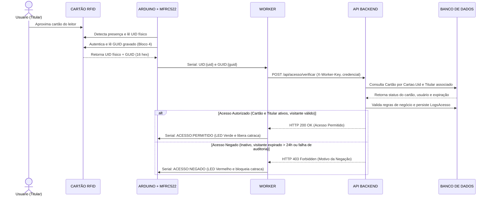

# Diagramas do Sistema de Controle de Acesso RFID

Este documento consolida a modelagem comportamental e de fluxo do sistema:

👉 **Arquivo para Draw.io / diagrams.net:** [Diagramas-Controle-Acesso.drawio](Diagramas-Controle-Acesso.drawio)

---

## Estrutura das Páginas no Draw.io (`Diagramas-Controle-Acesso.drawio`)

Ao abrir o arquivo no [draw.io](https://app.diagrams.net), você encontrará as seguintes abas:

| Página / Aba | Tipo de Diagrama | Descrição |
| :--- | :--- | :--- |
| **`Atividades - Validação`** | Diagrama de Atividades | Layout horizontal/paisagem em 4 estágios, tipografia ampliada (17-18px), zero sobreposição, pronto para print de artigo |
| **`Sequência - Validação (Artigo)`** | Diagrama de Sequência | Layout horizontal minimalista, fontes ampliadas (15-16px), 6 linhas de vida e bloco `alt` conciso de desfechos |

---

## 1. Diagrama de Atividades: Validação de Acesso (Layout Artigo 16:9)

Diagrama de atividades com fluxo horizontal em 4 estágios lineares, caixas brancas com bordas em azul petróleo (`#4a7c9d`), losangos destacados, fontes ampliadas e rotas ortogonais sem sobreposição:

👉 **Para editar ou exportar em vetor de alta resolução:** Abra o arquivo [Diagramas-Controle-Acesso.drawio](Diagramas-Controle-Acesso.drawio) na aba **`Atividades - Validação`**.

```mermaid
%%{init: {
  "theme": "base",
  "themeVariables": {
    "primaryColor": "#ffffff",
    "primaryTextColor": "#1e293b",
    "primaryBorderColor": "#4a7c9d",
    "lineColor": "#4a7c9d",
    "secondaryColor": "#ffffff",
    "tertiaryColor": "#ffffff",
    "fontSize": "15px"
  }
}}%%
flowchart LR
    subgraph S1["1. Captura e Leitura de Borda"]
        Ini(["Início"]) --> Aprox["Usuário aproxima o cartão<br/>do leitor RFID (MFRC522)"]
        Aprox --> Read["Arduino lê UID físico e GUID<br/>do Bloco 4 e envia pela Serial"]
        Read --> Complete{"Worker recebeu<br/>UID e GUID?"}
        Complete -- "Não" --> Wait["Aguarda leitura<br/>dos dois dados"] --> Aprox
    end

    subgraph S2["2. Worker e Autenticação API"]
        Complete -- "Sim" --> Post["Worker envia POST<br/>/api/acesso/verificar<br/>(com cabeçalho X-Worker-Key)"]
        Post --> Auth{"Chave do Worker<br/>é válida?"}
    end

    subgraph S3["3. Regras de Negócio e Auditoria"]
        Auth -- "Sim" --> Query["API busca Cartão por<br/>Cartao.Uid e carrega Titular"]
        Query --> Rules{"Cartão Ativo, Titular Ativo<br/>e Visitante não expirado<br/>(< 24h)?"}
        
        Rules -- "Sim" --> LogOk["Persiste tentativa permitida<br/>em LogsAcesso (AcessoAutorizado)"]
        LogOk --> AuditCheck{"Auditoria gravada<br/>com sucesso?"}
        
        Rules -- "Não" --> LogDeny["Persiste tentativa negada<br/>em LogsAcesso (Negado)"]
    end

    subgraph S4["4. Desfecho e Sinalização"]
        AuditCheck -- "Sucesso" --> ResOk["HTTP 200 OK<br/>(Acesso Permitido)"]
        ResOk --> SerialOk["Worker envia Serial:<br/>ACESSO:PERMITIDO"]
        SerialOk --> LedGreen["Arduino acende o LED Verde<br/>e libera a catraca"]
        LedGreen --> EndOk(["Acesso Liberado"])

        Auth -- "Não" --> ResDeny["HTTP 403 Forbidden<br/>(Acesso Negado)"]
        AuditCheck -- "Falha (Fail-Secure)" --> ResDeny
        LogDeny --> ResDeny
        ResDeny --> SerialDeny["Worker envia Serial:<br/>ACESSO:NEGADO"]
        SerialDeny --> LedRed["Arduino acende o LED Vermelho<br/>e bloqueia a catraca"]
        LedRed --> EndDeny(["Acesso Negado"])
    end
```

---

## 2. Diagrama de Sequência: Validação de Acesso (Minimalista para Artigo)

Modelagem temporal limpa e focada no essencial da arquitetura, sem ruídos de baixo nível de firmware, com proporção horizontal (~1200 × 750 px) e alta legibilidade:

👉 **Para editar ou exportar em vetor de alta resolução:** Abra o arquivo [Diagramas-Controle-Acesso.drawio](Diagramas-Controle-Acesso.drawio) na aba **`Sequência - Validação (Artigo)`**.

