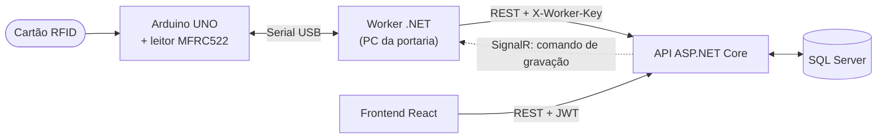
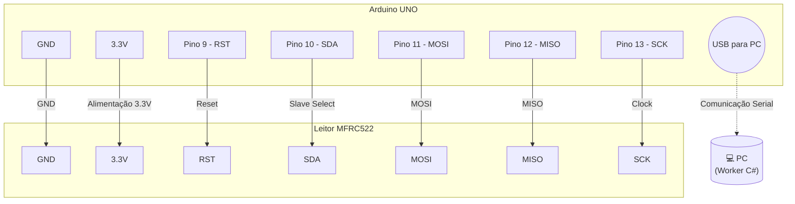

# Controle de Acesso RFID

Sistema que libera ou bloqueia a passagem de pessoas por cartão RFID. Um Arduino lê o cartão, um serviço .NET leva a leitura até uma API, a API decide se o acesso é permitido, registra a tentativa no SQL Server e devolve a resposta para acender o LED e acionar a catraca.

-1f6feb)


[](https://github.com/BDuArt3/Controle-de-acesso-RFID/actions/workflows/ci.yml)

> **Trabalho de Conclusão de Curso – Bacharelado em Sistemas de Informação, UNIPAM (2025)**

O repositório traz o sistema completo: firmware do Arduino, Worker .NET, API ASP.NET Core e a interface web em React (pasta [`frontend/`](frontend)).

## Demonstração

<!-- TODO: imagem - foto do Arduino UNO montado com o leitor MFRC522, LEDs e relé -->
<!-- TODO: imagem - GIF passando um cartão no leitor e o LED verde/vermelho acendendo -->
<!-- TODO: imagem - print da tela de login do frontend -->
<!-- TODO: imagem - print do dashboard -->
<!-- TODO: imagem - print da tela de logs de acesso com o filtro e a exportação PDF/CSV -->
<!-- TODO: imagem - print da emissão de cartão (tela esperando o cartão ser aproximado) -->

## Funcionalidades

- **Decisão de acesso no servidor:** o Arduino só lê o cartão. Quem decide é a API, que confere cartão, titular, status e validade.
- **Auditoria de todas as tentativas:** cada leitura, permitida ou negada, é gravada com data, local e motivo. Se o log não puder ser gravado, o acesso é negado (*fail-closed*).
- **Emissão e reemissão de cartões com confirmação do hardware:** a API manda o comando de gravação ao Worker por SignalR; o cartão só passa a valer depois que o Arduino confirma a gravação.
- **Cartões de visitante** com validade de 24 horas e bloqueio automático depois de vencidos.
- **Cadastro de pessoas e funcionários**, com histórico de ativação, desativação e mudanças de status.
- **Login com JWT e refresh token** com rotação e revogação. Senhas guardadas com hash BCrypt.
- **Três perfis de acesso:** Admin, Operador e Visualizador.
- **Relatórios** de acesso em CSV e PDF, com filtros de período e resultado.
- **Medição do tempo de resposta** do cartão até a liberação, gravada pelo Worker.
- **116 testes automatizados**: 79 no backend (xUnit, Moq e SQLite em memória) e 37 no frontend (Vitest + Testing Library), rodando no GitHub Actions a cada push.

## Arquitetura



**Fluxo de uma leitura:**

1. A pessoa aproxima o **cartão** do leitor.
2. O **Arduino** lê o UID do chip e a credencial gravada no cartão e envia tudo pela porta serial.
3. O **Worker** (.NET, rodando no PC ligado ao Arduino) junta as duas mensagens e chama `POST /api/acesso/verificar`, autenticado com uma chave de máquina.
4. A **API** consulta o **SQL Server**, aplica as regras (cartão ativo, titular ativo, validade de visitante), registra a tentativa e responde *permitido* (200) ou *negado* (403).
5. O Worker devolve `ACESSO:PERMITIDO` ou `ACESSO:NEGADO` ao Arduino, que acende o LED verde ou vermelho e aciona o relé da catraca por 2 segundos.
6. O **frontend** mostra os logs, permite cadastrar pessoas e emitir cartões.

O backend segue arquitetura em camadas:

| Camada | O que faz |
|---|---|
| `Core` | Entidades e regras de estado do domínio. Não depende de nenhuma outra camada. |
| `Application` | Casos de uso (serviços), DTOs e interfaces de repositório. |
| `Infrastructure` | EF Core, repositórios, migrations e seed do primeiro administrador. |
| `Api` | Controllers REST, autenticação JWT, autorização por perfil, SignalR e relatórios. |
| `Worker` | Ponte entre a porta serial do Arduino e a API. |

### Ligação do Arduino com o leitor



Sinalização: LED verde no pino 7, LED vermelho no pino 6 e relé da catraca no pino 5.

## Tecnologias

| Área | Tecnologias |
|---|---|
| Backend | C#, .NET 10, ASP.NET Core Web API, SignalR, Swagger |
| Banco de dados | SQL Server, Entity Framework Core 10 (migrations) |
| Segurança | JWT Bearer, refresh token com rotação, BCrypt, autenticação de máquina por chave |
| Hardware | Arduino UNO, leitor RFID MFRC522 (SPI), `System.IO.Ports` |
| Relatórios | QuestPDF (PDF) e CSV |
| Testes | xUnit, Moq, EF Core SQLite, Vitest, Testing Library |
| CI | GitHub Actions |
| Frontend | React 18, TypeScript, Vite, Tailwind CSS, shadcn/ui, Axios |

## Como rodar localmente

### Pré-requisitos

- [.NET SDK 10](https://dotnet.microsoft.com/download)
- SQL Server (Developer, Express ou em Docker)
- Para o hardware: Arduino IDE, Arduino UNO, leitor MFRC522 e cartões MIFARE
- Para a interface: Node.js 20+

### 1. Configurar a API

```powershell
cd src/Api
copy appsettings.Example.json appsettings.Development.json
```

Abra o `appsettings.Development.json` e preencha:

- `ConnectionStrings:DefaultConnection`: a conexão com o seu SQL Server
- `Jwt:SecretKey`: uma chave aleatória com 32 caracteres ou mais
- `WorkerAuth:ApiKey`: outra chave com 32 caracteres ou mais (o Worker vai usar a mesma)
- `BootstrapAdmin:Password` e `BootstrapAdmin:Document`: senha e documento do primeiro administrador, criado automaticamente na primeira execução com o e-mail `admin@tcc.com`

### 2. Criar o banco

```powershell
cd src/Api
dotnet tool restore
dotnet ef database update --project ../Infrastructure --startup-project .
```

### 3. Subir a API

```powershell
dotnet run --project src/Api
```

O Swagger fica em `http://localhost:5143/swagger` e o health check em `http://localhost:5143/health`.

### 4. Gravar o firmware no Arduino

1. Monte o circuito conforme o diagrama acima.
2. Na Arduino IDE, instale a biblioteca **MFRC522** (Library Manager).
3. Abra `src/Arduino/arduino/arduino.ino` e envie para a placa.
4. Anote a porta COM em que o Arduino apareceu (ex.: `COM4`).

### 5. Subir o Worker

```powershell
cd src/Worker
copy appsettings.Example.json appsettings.json
```

Preencha `WorkerAuth:ApiKey` com a mesma chave da API e `SerialPortSettings:ComPortName` com a porta do Arduino. Depois:

```powershell
dotnet run --project src/Worker
```

### 6. Subir o frontend

```powershell
cd frontend
npm install
copy .env.example .env.api-local
npm run dev
```

O `.env.api-local` aponta para a API local (`http://localhost:5143/api`). A interface abre em `http://localhost:5173`; entre com `admin@tcc.com` e a senha definida em `BootstrapAdmin:Password`. Mais detalhes no [README do frontend](frontend/README.md).

### 7. Rodar os testes

```powershell
dotnet test ControleDeAcessoRfid.sln
cd frontend
npm test
```

Os testes não precisam de SQL Server nem de Arduino: usam SQLite em memória e mocks.

## Estrutura de pastas

```
Controle-de-acesso-RFID/
├── src/
│   ├── Core/             # Entidades e regras de domínio
│   ├── Application/      # Serviços (casos de uso), DTOs e interfaces
│   ├── Infrastructure/   # EF Core, repositórios, migrations e seed
│   ├── Api/              # Controllers, autenticação, SignalR e relatórios PDF
│   ├── Worker/           # Ponte entre a porta serial e a API
│   └── Arduino/          # Firmware do Arduino (leitura e gravação RFID)
├── frontend/             # Interface web (React + TypeScript + Vite)
├── tests/
│   └── ControleDeAcesso.Tests/   # Testes xUnit
├── docs/
│   └── GUIA_APRESENTACAO.md      # Explicação detalhada de regras e decisões
└── ControleDeAcessoRfid.sln
```

Para entender as regras de negócio, as decisões técnicas e as limitações conhecidas, leia o [guia de estudo e apresentação](docs/GUIA_APRESENTACAO.md).

## Autor

**Bruno Duarte**: Bacharel em Sistemas de Informação pela UNIPAM.

[](https://www.linkedin.com/in/brunoduartes)
[](https://github.com/BDuArt3)

## Licença

Distribuído sob a licença MIT. Veja [LICENSE](LICENSE).
