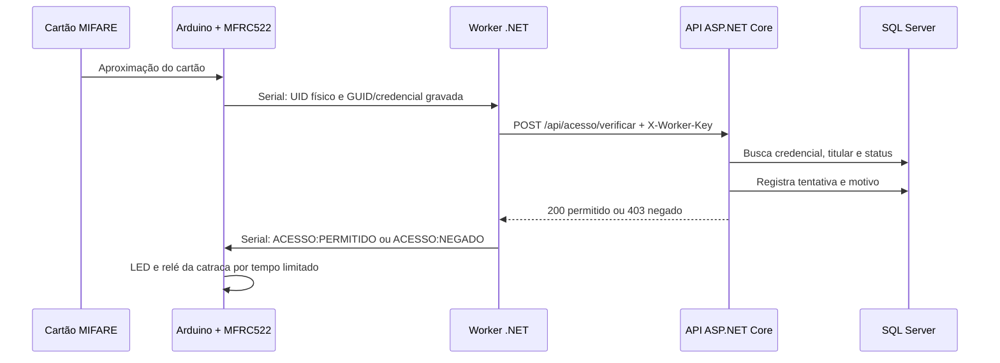

# Guia de estudo e apresentação — Controle de Acesso RFID

Este guia explica o projeto a partir do código da solution. Ele foi organizado
para servir tanto como mapa do repositório quanto como material de preparação
para perguntas de avaliação. Os links apontam para os arquivos onde cada
comportamento pode ser demonstrado.

## 1. Resumo para apresentar

### Explicação de 30 segundos

> O projeto controla o acesso físico de pessoas por cartões RFID. Um Arduino
> com leitor MFRC522 lê o cartão e conversa por serial com um serviço Worker
> em .NET. O Worker envia a credencial à API, que verifica cartão, titular,
> status e validade no SQL Server, registra a tentativa e devolve autorização
> ou recusa. A API também permite administrar usuários e funcionários, emitir
> e reemitir cartões com confirmação do hardware, consultar auditoria e exportar
> relatórios.

### Objetivo e valor do sistema

- Centralizar o cadastro de titulares, funcionários, cartões e permissões.
- Tomar a decisão de acesso no servidor, em vez de confiar apenas no leitor.
- Registrar tentativas permitidas e negadas com horário, local e motivo.
- Controlar emissão e reemissão de cartões com confirmação do dispositivo.
- Manter histórico de mudanças para apoiar auditoria e investigação.

O repositório contém backend, Worker, firmware Arduino e testes. A interface
web (React) fica em um repositório separado,
[Controle-de-acesso-RFID-Frontend](https://github.com/BDuArt3/Controle-de-acesso-RFID-Frontend),
que consome esta API.

## 2. Arquitetura e fluxo ponta a ponta

### Componentes

| Componente | Responsabilidade | Tecnologias principais |
|---|---|---|
| Core | Entidades, enums e regras de estado do domínio | C# / .NET 10 |
| Application | Serviços, interfaces de repositório e DTOs | C# / .NET 10, BCrypt.Net-Next, JWT |
| Infrastructure | EF Core, SQL Server, repositórios, migrations e seed | EF Core 10, SQL Server |
| API | Endpoints REST, autenticação, autorização, SignalR e relatórios | ASP.NET Core 10, JWT Bearer, SignalR, Swagger, QuestPDF |
| Worker | Integração entre API, SignalR e porta serial | .NET Worker Service, SignalR Client, `System.IO.Ports` |
| Firmware | Leitura/gravação RFID e acionamento de sinalização/catraca | Arduino C++, SPI, biblioteca MFRC522 |
| Tests | Testes de regras, integração com SQLite e testes de componentes | xUnit, Moq, EF Core SQLite |

O fluxo de dependências é: `Core` não depende das outras camadas; `Application`
depende do `Core`; `Infrastructure` implementa os repositórios definidos pela
Application; a API conecta Application e Infrastructure; e o Worker usa DTOs
da Application para conversar com a API. Os projetos estão descritos na
[solution](../ControleDeAcessoRfid.sln).

### Leitura de acesso



O Arduino envia o UID físico do chip e o código gravado na memória. O Worker
combina as duas mensagens seriais e envia ambas à API. No endpoint, a API
prioriza `Guid` como credencial lógica e usa `Uid` como fallback se o campo
`Guid` estiver ausente. Essa separação permite que o sistema use um código
associado pelo próprio sistema, sem tratar o identificador físico como a
credencial principal.

### Emissão ou reemissão

1. Um funcionário autorizado solicita a operação pela API e envia
   `Idempotency-Key`.
2. A Application valida titular, solicitante, cartão anterior e conflitos;
   gera uma credencial hexadecimal de 16 caracteres e persiste a solicitação.
3. Se houver Worker conectado, a API envia `ReceberComandoGravacao` pelo
   SignalR. A solicitação continua consultável se o dispositivo estiver
   desconectado.
4. O Worker envia `WRITE:<credencial>` pela serial. O Arduino espera um cartão
   compatível, autentica o bloco e tenta gravar.
5. O Arduino devolve `SUCCESS:`, `ERROR:` ou `TIMEOUT:`. O Worker chama o
   endpoint de confirmação ou de falha.
6. Só após confirmação válida a API cria o cartão lógico e os registros
   iniciais de associação/status. Em reemissão, o cartão anterior é cancelado
   e sua associação é encerrada nessa conclusão.

O Worker tolera indisponibilidade da serial e tenta manter SignalR conectado
com reconexão automática. A espera do Arduino por um cartão é de até 15
segundos; o Worker usa um timeout de 17 segundos para a confirmação serial.

## 3. Tecnologias e decisões

### Backend e persistência

- **C# e .NET 10**: API, camadas de domínio/aplicação/infraestrutura, Worker e
  testes têm `TargetFramework` `net10.0`.
- **ASP.NET Core Web API**: controllers REST, validação de DTOs, middleware
  de autenticação/autorização, CORS e endpoint de saúde.
- **Entity Framework Core 10 com SQL Server**: mapeia o domínio relacional,
  índices, restrições e migrations. A conexão configura retentativas para
  falhas transitórias do SQL Server.
- **SQLite nos testes**: permite testar persistência e transações sem depender
  de uma instância SQL Server externa.
- **SignalR**: canal servidor-Worker para enviar comandos de gravação em tempo
  real. REST continua sendo usado para decisões de acesso e callbacks de
  confirmação/falha.
- **Swagger/Swashbuckle**: documentação interativa da API.
- **QuestPDF**: geração de relatório PDF; o controller também gera CSV.

### Dispositivo e comunicação

- **Arduino UNO + MFRC522**: o leitor utiliza SPI; a comunicação Arduino-PC
  usa serial a 9600 baud.
- **`System.IO.Ports`**: leitura e escrita da porta serial no Worker.
- **Protocolo serial textual**: mensagens com prefixos `UID:`, `GUID:`,
  `WRITE:`, `SUCCESS:`, `ERROR:`, `TIMEOUT:` e respostas
  `ACESSO:PERMITIDO`/`ACESSO:NEGADO`.
- **Sinalização física**: LED verde no pino 7, vermelho no pino 6 e relé no
  pino 5; o feedback de acesso dura dois segundos no firmware.

### Por que separar em camadas?

O domínio e as regras de negócio ficam menos dependentes de ASP.NET, EF Core e
hardware. A Application coordena os casos de uso usando interfaces; a
Infrastructure fornece acesso ao banco; a API cuida do protocolo HTTP; o
Worker isola a operação local do hardware. Isso facilita testar regras sem
Arduino nem banco SQL Server e permite substituir componentes mantendo os
contratos das camadas.

### Por que usar SignalR além de REST?

A solicitação de gravação nasce em uma chamada REST, mas o comando precisa
chegar a um Worker conectado sem que ele consulte a API repetidamente. SignalR
oferece esse canal servidor-cliente em tempo real. A confirmação física e os
erros voltam por endpoints REST, com resposta explícita e persistência do
estado da solicitação.

## 4. Domínio e modelo de dados

| Entidade | Papel no domínio |
|---|---|
| `Usuario` | Pessoa que receberá acesso: aluno, professor, visitante ou colaborador. Mantém dados de identificação e situação ativa. |
| `Funcionario` | Conta interna de operação/administração ligada 1:1 a um `Usuario`; guarda hash da senha, departamento, cargo, papel de autorização e situação ativa. |
| `Cartao` | Cartão lógico associado a um usuário, com credencial, status, data de registro e expiração opcional. |
| `LogAcesso` | Tentativa de acesso: data/hora UTC, local, resultado, motivo classificado e referências ao cartão/usuário quando conhecidos. |
| `HistoricoAssociacoesCartao` | Quando e por quem o cartão foi associado/desassociado. |
| `HistoricoStatusCartao` | Mudanças de status do cartão, com horário, motivo e funcionário responsável. |
| `HistoricoStatusUsuario` / `HistoricoStatusFuncionario` | Eventos de ativação/desativação, com motivo, data e responsável. |
| `SolicitacaoGravacaoCartao` | Ciclo persistente de emissão/reemissão: credencial, chave idempotente, solicitante, estado, tentativas e falhas. |
| `RefreshToken` | Hash do refresh token, funcionário, validade, revogação e hash substituto na rotação. |

`Usuario` e `Funcionario` representam conceitos diferentes: uma pessoa pode
ser titular de cartão sem possuir conta para entrar no sistema administrativo.
Somente funcionários têm senha e papel de autorização.

### Regras e integridade

- Status do cartão: `Ativo = 0`, `Bloqueado = 1`, `Cancelado = 2`. Um cartão
  cancelado não pode voltar a outro estado; a entidade protege essa transição.
- O banco impõe unicidade para credencial do cartão e e-mail não nulo, além de
  um índice filtrado para limitar cada usuário a um cartão ativo.
- Solicitações também têm unicidade para credencial e para o par
  solicitante/chave idempotente. Um índice filtrado impede mais de uma
  solicitação aberta para o mesmo cartão anterior.
- As relações históricas usam `NoAction` em vez de apagar em cascata, para
  preservar referências de auditoria.
- As operações críticas usam `UnitOfWork` com estratégia de execução do EF
  Core e transação `Serializable`; testes verificam rollback quando falha a
  gravação da auditoria.
- Cartões de visitantes recebem expiração de 24 horas após confirmação de
  emissão. Na primeira tentativa posterior à expiração, o acesso é negado e
  o cartão é bloqueado com histórico.

## 5. Autenticação, senhas e autorização

### Senhas: hash BCrypt

As senhas de funcionários não são armazenadas em texto puro nem criptografadas
para recuperação. O campo persistido é `Funcionario.SenhaHash`:

- Na criação/alteração de funcionário, `BCrypt.Net.BCrypt.HashPassword(...)`
  produz o hash (BCrypt usa salt e é deliberadamente custoso).
- No login, `BCrypt.Net.BCrypt.Verify(senhaInformada, funcionario.SenhaHash)`
  compara a senha com o hash armazenado, sem descriptografá-lo.
- O seed do administrador inicial também chama `HashPassword`.

Pontos para localizar: [AuthService.cs](../src/Application/Services/AuthService.cs),
[FuncionarioService.cs](../src/Application/Services/FuncionarioService.cs),
[SeedData.cs](../src/Infrastructure/Data/SeedData.cs),
[Funcionario.cs](../src/Core/Entities/Funcionario.cs).

### JWT e refresh token

- O **access token JWT** é assinado com HMAC-SHA256 e inclui identificador,
  nome, e-mail, papel e tipo do funcionário. `Issuer`, `Audience`, chave e
  duração vêm da configuração `Jwt:*`; o padrão de duração usado no código é
  60 minutos. A validação verifica assinatura, emissor, audiência e validade,
  sem tolerância de relógio (`ClockSkew = 0`).
- O **refresh token** é gerado com 64 bytes aleatórios criptograficamente
  seguros e entregue ao cliente em Base64. O banco guarda somente o SHA-256
  hexadecimal do token, não o token bruto. Sua validade é de sete dias.
- Ao renovar, o refresh token anterior é revogado e substituído por outro;
  tentativas com token expirado, revogado ou já utilizado são rejeitadas.
- O logout revoga o refresh token recebido. O access token JWT permanece
  válido até expirar; não há revogação individual de JWT implementada.

Pontos para localizar: [AuthService.cs](../src/Application/Services/AuthService.cs),
[AuthController.cs](../src/Api/Controllers/AuthController.cs),
[RefreshToken.cs](../src/Core/Entities/RefreshToken.cs) e o mapeamento em
[AppDbContext.cs](../src/Infrastructure/Data/AppDbContext.cs).

### Papéis e políticas

| Papel | Permissões em linhas gerais |
|---|---|
| `Admin` | Administração completa, incluindo funcionários e histórico. |
| `Operador` | Operações de cadastro/gestão de usuários e emissão de cartões previstas nas políticas. |
| `Visualizador` | Consulta, incluindo listagens e logs que usam `TodosFuncionarios`. |

A API declara as políticas `AdminOnly`, `AdminOrOperador` e
`TodosFuncionarios`. Os controllers aplicam essas políticas por endpoint.
Confirme o atributo específico do endpoint antes de afirmar que um papel pode
executar uma operação: por exemplo, a gestão de funcionários é restrita a
administradores. As rotas do Worker usam uma política separada, `WorkerCallback`.

### Autenticação do Worker

O Worker envia o header `X-Worker-Key`. Um esquema de autenticação próprio
exige chave configurada com pelo menos 32 caracteres e compara os bytes com
`CryptographicOperations.FixedTimeEquals`. A identidade autenticada recebe a
claim `machine_type=rfid-worker`; a política `WorkerCallback` exige essa claim.
Essa política protege a verificação de acesso, os callbacks de gravação e o
Hub SignalR.

Veja [WorkerApiKeyAuthenticationHandler.cs](../src/Api/Security/WorkerApiKeyAuthenticationHandler.cs),
[Program.cs](../src/Api/Program.cs),
[AcessoController.cs](../src/Api/Controllers/AcessoController.cs) e
[GravacaoHub.cs](../src/Api/Hubs/GravacaoHub.cs).

## 6. Regras de decisão de acesso e auditoria

A decisão principal está em `AcessoService.CheckAccessAsync`:

1. Normaliza o local e rejeita local com mais de 100 caracteres.
2. Recusa credencial vazia ou cartão não cadastrado.
3. Exige cartão ativo e titular existente/ativo.
4. Se for cartão de visitante vencido, bloqueia-o e grava o histórico.
5. Registra o resultado e o motivo antes de devolver autorização.

Os motivos classificados incluem UID obrigatório, cartão não encontrado,
cartão desativado/expirado, usuário não encontrado/desativado, acesso
autorizado e erro interno. Tentativas com credencial desconhecida são
registradas sem referências de cartão/usuário; quando o cartão é conhecido, o
log guarda as chaves correspondentes.

**A auditoria é fail-closed:** se não for possível persistir o log, o serviço
não devolve acesso permitido. Essa decisão prioriza rastreabilidade e evita
liberar passagem sem conseguir registrar a tentativa.

O endpoint retorna `200` para permitido e `403` para negado; o Worker converte
qualquer resposta HTTP não bem-sucedida em `ACESSO:NEGADO`. O firmware aciona o
LED/relé a partir desse comando.

Veja [AcessoService.cs](../src/Application/Services/AcessoService.cs),
[LogAcessoService.cs](../src/Application/Services/LogAcessoService.cs),
[LogAcesso.cs](../src/Core/Entities/LogAcesso.cs),
[LogAcessoController.cs](../src/Api/Controllers/LogAcessoController.cs) e
[AccessFeedbackSerialProtocol.cs](../src/Worker/AccessFeedbackSerialProtocol.cs).

## 7. Relatórios, medições e observabilidade

- O endpoint de exportação de logs aceita CSV ou PDF e filtros de período e
  resultado. O CSV é emitido em UTF-8 com BOM; o PDF é paisagem A4, apresenta
  contagens e paginação e converte os horários para `America/Sao_Paulo`.
- O Worker mede o tempo total desde a primeira mensagem serial do cartão e o
  tempo da chamada à API, guardando status HTTP e resultado em JSON Lines.
  `MedicaoTempoResposta` também lê o formato antigo como JSON-array e oferece
  resumo de média, mínimo e máximo.
- O Worker pode ser iniciado com `--resumo-medicoes [caminho]` para imprimir
  resumo do arquivo de medições.
- `/health` informa se o banco está disponível no corpo da resposta. O código
  retorna HTTP 200 também no estado degradado; consumidores devem olhar o campo
  `status`, não apenas o status HTTP.

Veja [LogAcessoController.cs](../src/Api/Controllers/LogAcessoController.cs),
[LogAcessoPdfGenerator.cs](../src/Api/Reports/LogAcessoPdfGenerator.cs),
[MedicaoTempoResposta.cs](../src/Worker/MedicaoTempoResposta.cs) e
[Program.cs do Worker](../src/Worker/Program.cs).

## 8. Principais rotas para demonstrar

As rotas usam prefixo `/api`. O nome abaixo é o segmento relevante do
controller; consulte o atributo e a política no arquivo antes de demonstrar.

| Área | Rotas representativas | Acesso |
|---|---|---|
| Autenticação | `POST /api/Auth/login`, `POST /api/Auth/refresh-token`, `POST /api/Auth/logout`, `GET /api/Auth/me` | Login/refresh/logout anônimos; `me` exige JWT |
| Acesso físico | `POST /api/Acesso/verificar` | Somente Worker autenticado |
| Funcionários | `POST/GET/PUT/DELETE /api/Funcionario` e ativação | Administração de funcionários restrita a Admin |
| Usuários | CRUD em `/api/Usuario` e ativação | Leitura disponível para funcionários; escrita conforme políticas do controller |
| Cartões | `/api/Cartao`, solicitação, consulta, retentativa e cancelamento | Emissão/gestão conforme `AdminOrOperador`; consultas conforme atributos |
| Callback do Worker | `POST /api/cartao/confirmar-gravacao`, `POST /api/cartao/falhar-gravacao` | Chave do Worker |
| Logs | `/api/LogAcesso`, `/api/log-acesso/exportar`, filtros e estatísticas | JWT; leitura/exportação usa `TodosFuncionarios` |
| Histórico | `GET /api/usuario/{id}/historico`, `/api/funcionario/{id}/historico`, `/api/cartao/{id}/historico` | Admin |
| Infraestrutura | `GET /health`, Swagger | Health e documentação mapeados no startup |

Pontos para consultar: [AuthController.cs](../src/Api/Controllers/AuthController.cs),
[AcessoController.cs](../src/Api/Controllers/AcessoController.cs),
[FuncionarioController.cs](../src/Api/Controllers/FuncionarioController.cs),
[UsuarioController.cs](../src/Api/Controllers/UsuarioController.cs),
[CartaoController.cs](../src/Api/Controllers/CartaoController.cs),
[WorkerGravacaoController.cs](../src/Api/Controllers/WorkerGravacaoController.cs),
[LogAcessoController.cs](../src/Api/Controllers/LogAcessoController.cs) e
[HistoricoController.cs](../src/Api/Controllers/HistoricoController.cs).

## 9. Configuração e execução

### Configurações que a aplicação espera

Os nomes abaixo são chaves de configuração, não valores para publicar:

- API: `ConnectionStrings:DefaultConnection`, `Jwt:SecretKey`,
  `Jwt:Issuer`, `Jwt:Audience`, `Jwt:ExpirationInMinutes`,
  `WorkerAuth:ApiKey`, `Cors:AllowedOrigins`,
  `BootstrapAdmin:Password` e `BootstrapAdmin:Document`.
- Worker: `ApiSettings:BaseUrl`, `WorkerAuth:ApiKey`,
  `SerialPortSettings:ComPortName`, `AccessPoint:Location`,
  `Medicao:Habilitada` e `Medicao:CaminhoArquivo`.
- O Worker exige URL absoluta HTTP/HTTPS, valida a chave mínima de 32
  caracteres e usa `COM4` como porta padrão se nenhuma porta for configurada.

Não copie valores de senha, connection string, chave JWT ou chave do Worker
para slides, README, issues ou logs. Os arquivos `appsettings.json` e
`appsettings.*.json` reais ficam fora do git (estão no `.gitignore`); o
repositório traz apenas modelos com valores fictícios:
[API](../src/Api/appsettings.Example.json) e
[Worker](../src/Worker/appsettings.Example.json). Em produção, os segredos
devem vir de User Secrets, variáveis de ambiente ou da configuração segura do
Azure.

### Inicialização e banco

No startup, a API tenta conectar ao banco e executar o seed do administrador
inicial quando ainda não existe Admin. O seed exige `BootstrapAdmin:Password`
e `BootstrapAdmin:Document` e armazena a senha via BCrypt. Se o banco não
estiver disponível, a API registra aviso e continua iniciando; nesse caso o
seed não é executado.

O projeto mantém migrations EF Core em `src/Infrastructure/Migrations`. O
startup mostrado não executa `Database.Migrate()` automaticamente, portanto a
aplicação/deploy precisa garantir que o schema foi aplicado antes de depender
das tabelas novas.

### CI/CD

O workflow do GitHub Actions dispara em push para `main` ou manualmente. Ele
usa .NET 10, roda testes, build e publish da API, e implanta o artefato em um
Azure Web App via Azure Login/OIDC. Esse pipeline publica **a API**, não o
Worker nem o firmware Arduino. O Worker deve rodar em uma máquina que tenha
acesso físico à porta serial do Arduino.

Veja [workflow de deploy](../.github/workflows/main_controle-acesso.yml).

## 10. Testes existentes

O projeto de testes usa xUnit, Moq e EF Core SQLite. A suíte cobre, entre
outros:

- login, persistência, rotação e revogação de refresh tokens;
- emissão, confirmação repetida, colisões de credencial, visitante e
  reemissão de cartão;
- bloqueio de acesso para cartão/titular inválido, visitante vencido e falha
  de auditoria;
- transições de status e rollback de mudanças quando a auditoria falha;
- controllers, histórico, exportação CSV/PDF, Worker API client, protocolo
  serial e medições de latência.

Arquivos representativos: [CardIssuanceTests.cs](../tests/ControleDeAcesso.Tests/CardIssuanceTests.cs),
[AccessAttemptTests.cs](../tests/ControleDeAcesso.Tests/AccessAttemptTests.cs),
[RefreshTokenPersistenceTests.cs](../tests/ControleDeAcesso.Tests/RefreshTokenPersistenceTests.cs),
[AuditTransactionTests.cs](../tests/ControleDeAcesso.Tests/AuditTransactionTests.cs),
[WorkerApiClientTests.cs](../tests/ControleDeAcesso.Tests/WorkerApiClientTests.cs) e
[LogAcessoExportTests.cs](../tests/ControleDeAcesso.Tests/LogAcessoExportTests.cs).

Comando usado no CI:

```powershell
dotnet test ControleDeAcessoRfid.sln --configuration Release
```

## 11. Perguntas prováveis do avaliador

### “Como o sistema decide se abre a catraca?”

O Arduino lê os dados e o Worker chama `POST /api/Acesso/verificar`. A API
consulta a credencial, o cartão e o titular no banco, valida status/expiração
e grava a auditoria. Só então devolve permitido ou negado; o Worker envia o
resultado serial e o Arduino controla o feedback/relé.

### “Por que existe um GUID gravado no cartão além do UID físico?”

O projeto separa o identificador físico do cartão da credencial lógica
registrada no sistema. A credencial lógica é gerada pelo backend e é o dado
principal para a autorização; o UID físico segue disponível para diagnóstico
e contexto. No código, o campo `Cartao.Uid` é usado para guardar essa
credencial, apesar do nome poder ser confundido com o UID físico.

### “Onde fica o hash da senha?”

Em `Funcionario.SenhaHash`. A senha é transformada com
`BCrypt.Net.BCrypt.HashPassword` quando o funcionário é criado/atualizado e
validada com `BCrypt.Net.BCrypt.Verify` durante o login. O valor persistido é
hash, não senha reversível.

### “O que muda entre access token e refresh token?”

O access token é um JWT assinado e de vida curta usado nas chamadas protegidas.
O refresh token é opaco, aleatório, tem validade de sete dias e permite obter
novos tokens. A API guarda apenas seu SHA-256 e, ao utilizá-lo, revoga o
anterior e salva o substituto.

### “Como vocês impedem que qualquer pessoa grave um cartão?”

As operações administrativas exigem JWT e políticas de papel. A comunicação
do Worker também exige uma chave de máquina no header `X-Worker-Key`, validada
por um esquema e política próprios. O comando de gravação só é enviado pelo
Hub a um Worker autenticado.

### “E se o Worker ou o Arduino estiver desconectado?”

A solicitação de gravação fica persistida e pode ser consultada. O controller
retorna o estado em vez de fingir que o cartão já foi gravado; há operações
para retentar e cancelar. Se não chegar confirmação do hardware, o Worker
registra falha ou timeout e a solicitação continua rastreável.

### “Como evitam cartões duplicados ou repetição da requisição?”

A emissão exige `Idempotency-Key`, com unicidade por solicitante. Repetir a
mesma chave e os mesmos dados recupera a solicitação; reutilizar com dados
diferentes é conflito. A transação serializável, índices únicos e validações
no serviço/banco também protegem credenciais e cartões ativos.

### “Por que criar o cartão no banco somente depois da gravação?”

Uma solicitação não prova que o hardware gravou o cartão. A persistência do
cartão lógico e seus registros iniciais acontece após confirmação autenticada,
validando que a credencial confirmada corresponde à solicitação. Isso reduz a
chance de o cadastro indicar como válido um cartão que não foi gravado.

### “Como funciona a reemissão?”

O cartão anterior precisa pertencer ao mesmo titular e estar ativo; é
bloqueado enquanto a nova gravação está pendente. Se a gravação for confirmada,
o novo cartão é criado e o anterior é cancelado/desassociado. Se a solicitação
for cancelada, o serviço pode restaurar o estado anterior conforme as regras
implementadas.

### “Por que bloquear se o banco/a auditoria falhar?”

Para não liberar acesso sem conseguir persistir a trilha de auditoria. Essa é
uma escolha fail-closed: disponibilidade pode ser menor quando o banco falha,
mas uma falha de registro nunca se transforma em uma autorização silenciosa.

### “Como funciona a validade de visitante?”

Na confirmação da emissão, o cartão de visitante recebe expiração de 24 horas.
Uma tentativa posterior é negada, muda o status para bloqueado e cria histórico
da mudança, além do log da tentativa.

### “Como o sistema mantém histórico?”

Mudanças de associação e de status são entidades próprias; o log de acesso
guarda tentativas e motivos. Os registros apontam para o funcionário
responsável quando aplicável. As transações agrupam estado e auditoria para
evitar persistir um sem o outro em operações críticas.

### “Como vocês testam sem o hardware e sem o SQL Server?”

As regras são exercitadas em testes unitários com Moq. Nos testes de
persistência/transação, EF Core SQLite usa banco local temporário; assim é
possível testar constraints e rollback sem SQL Server. O protocolo serial e o
cliente HTTP do Worker também têm testes específicos.

### “O que o projeto ainda não implementa?”

O frontend fica no repositório separado citado na seção 1. Também não há publicação automática do
Worker/firmware pelo pipeline; o Worker depende de uma máquina conectada ao
Arduino. O código observado não aplica migrations automaticamente no startup.

## 12. Limitações e melhorias que vale reconhecer

Responder com clareza a estas limitações demonstra compreensão do escopo e
evita prometer uma segurança maior do que o código oferece:

1. **Segurança do cartão físico:** o firmware usa a chave padrão
   `FF FF FF FF FF FF` do MIFARE Classic e grava uma credencial legível de 16
   caracteres no bloco 4. Isso serve para demonstração/protótipo, mas não
   oferece a proteção de um cartão criptográfico moderno; alguém com leitor
   compatível e conhecimento da chave pode copiar o conteúdo. Para produção de
   maior criticidade, usar cartões/protocolo criptográfico mais robustos,
   chaves individuais e gestão segura de chaves.
2. **Credencial de 16 caracteres:** o serviço deriva 16 dígitos hexadecimais
   de um `Guid` e verifica colisões no banco. Isso resulta em 64 bits
   representados; a implementação deve ser reavaliada se o modelo de ameaça
   exigir resistência maior a clonagem ou enumeração.
3. **Segredos de desenvolvimento:** configurações sensíveis aparecem no
   arquivo de desenvolvimento versionado. Rotacionar credenciais reais,
   removê-las de arquivos rastreados e usar armazenamento de segredos é
   prioridade antes de abrir o repositório ou usá-lo em produção.
4. **Escala horizontal:** a presença de Workers conectados é mantida em
   memória estática e o despacho usa `Clients.All`. Com múltiplas instâncias
   da API, seria necessário backplane/registro distribuído e estratégia de
   roteamento do comando ao Worker correto.
5. **Hardening da API:** Swagger é mapeado em todos os ambientes e o
   redirecionamento HTTPS está comentado no startup. Configurar HTTPS e limitar
   documentação/diagnósticos conforme política de produção.
6. **Operação do banco:** a API pode iniciar sem banco e `/health` retorna 200
   também em estado degradado. Em implantação, avaliar health checks distintos
   de liveness/readiness e execução controlada das migrations.
7. **Hardware:** o comportamento seguro do relé, a instalação elétrica, o
   estado em perda de energia e a segurança mecânica da catraca dependem da
   montagem física; precisam de validação independente do software.

Esses itens não anulam o objetivo acadêmico: mostram a diferença entre um
protótipo funcional ponta a ponta e um sistema pronto para ambientes de alta
criticidade.

## 13. Mapa rápido de código para a apresentação

| Pergunta/parte da demo | Comece por |
|---|---|
| Composição, DI, JWT, políticas, CORS, SignalR, seed e health | [Program.cs da API](../src/Api/Program.cs) |
| Login, BCrypt, JWT e refresh tokens | [AuthService.cs](../src/Application/Services/AuthService.cs) e [AuthController.cs](../src/Api/Controllers/AuthController.cs) |
| Hash de senha no cadastro | [FuncionarioService.cs](../src/Application/Services/FuncionarioService.cs) |
| Entidades e status do domínio | [Entities](../src/Core/Entities) |
| Regras para permitir/negar | [AcessoService.cs](../src/Application/Services/AcessoService.cs) |
| Auditoria de acesso e consulta/exportação | [LogAcessoService.cs](../src/Application/Services/LogAcessoService.cs), [LogAcessoController.cs](../src/Api/Controllers/LogAcessoController.cs) |
| Geração e ciclo de gravação do cartão | [CartaoService.cs](../src/Application/Services/CartaoService.cs), [CartaoController.cs](../src/Api/Controllers/CartaoController.cs) |
| Persistência, constraints e relações | [AppDbContext.cs](../src/Infrastructure/Data/AppDbContext.cs), [Repositories](../src/Infrastructure/Data/Repositories) |
| Transação e rollback | [UnitOfWork.cs](../src/Infrastructure/Data/UnitOfWork.cs), [AuditTransactionTests.cs](../tests/ControleDeAcesso.Tests/AuditTransactionTests.cs) |
| Autenticação do Worker e Hub | [WorkerApiKeyAuthenticationHandler.cs](../src/Api/Security/WorkerApiKeyAuthenticationHandler.cs), [GravacaoHub.cs](../src/Api/Hubs/GravacaoHub.cs) |
| Porta serial, chamadas HTTP e feedback | [Worker.cs](../src/Worker/Worker.cs), [WorkerApiClient.cs](../src/Worker/WorkerApiClient.cs) |
| Protocolo do Arduino e relé | [arduino.ino](../src/Arduino/arduino/arduino.ino) |
| PDF e CSV | [LogAcessoPdfGenerator.cs](../src/Api/Reports/LogAcessoPdfGenerator.cs), [LogAcessoController.cs](../src/Api/Controllers/LogAcessoController.cs) |
| Testes e deploy | [tests](../tests/ControleDeAcesso.Tests), [workflow](../.github/workflows/main_controle-acesso.yml) |
