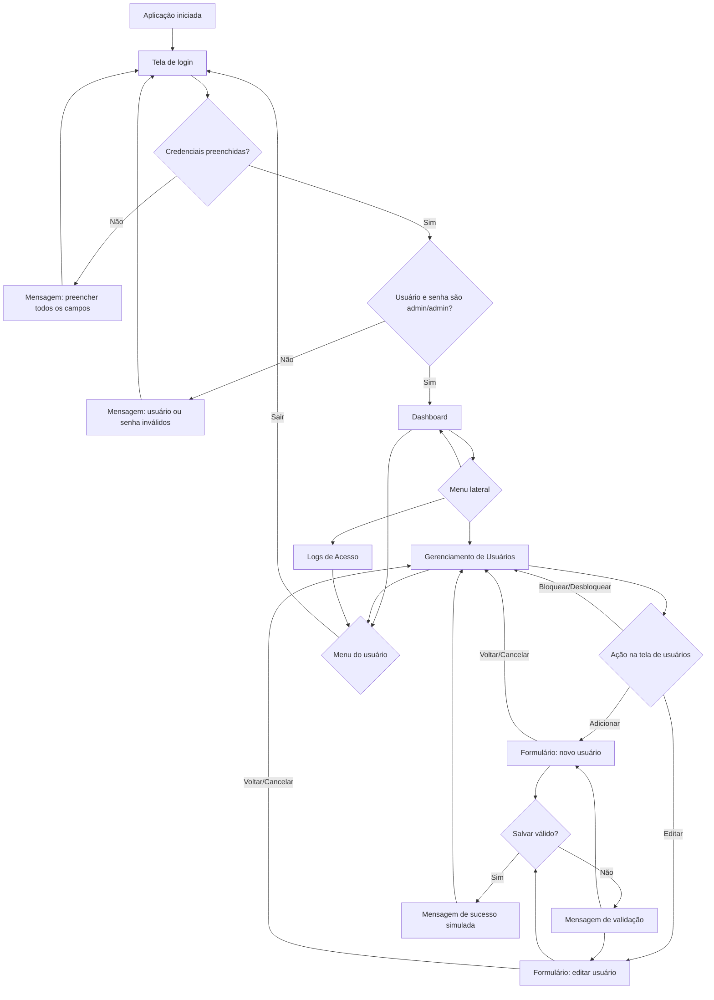
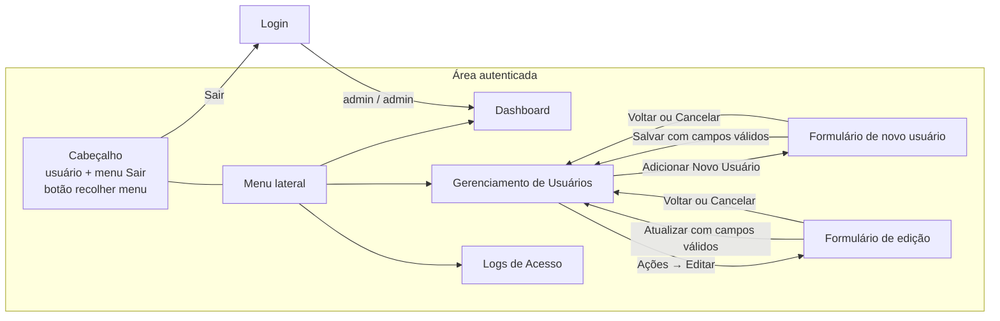

# Mapa do fluxo do frontend

Este documento descreve o fluxo que está implementado no frontend, incluindo as telas, os caminhos de navegação e o comportamento dos controles. O projeto funciona como uma demonstração: os dados e algumas operações são simulados no próprio navegador.

## 1. Visão geral da navegação

O menu lateral também pode ser recolhido/reaberto pelo botão de menu no cabeçalho. A navegação é mantida em estado React: as telas não possuem URLs ou rotas de navegador próprias.

## 2. Fluxo de login

1. Ao iniciar, a aplicação apresenta a tela de login.
2. A pessoa informa usuário e senha e escolhe **Entrar**.
3. Se algum campo estiver vazio, aparece a mensagem **“Por favor, preencha todos os campos.”**
4. Se ambos estiverem preenchidos, o frontend aguarda aproximadamente um segundo e compara os valores:
   - `admin` / `admin`: login aceito; abre o Dashboard.
   - Qualquer outra combinação: aparece **“Usuário ou senha inválidos.”**
5. O ícone de olho alterna a exibição da senha.
6. O cabeçalho autenticado apresenta o nome **Bruno Duarte** e o usuário informado.
7. Em **Sair**, a sessão de demonstração é encerrada, os dados do usuário autenticado são limpos e a tela de login volta a ser exibida.

> **Limite atual:** não há autenticação com servidor. As credenciais são verificadas no frontend e o acesso demonstrativo é fixo.

## 3. Telas após o login

### 3.1 Dashboard

É a tela inicial após o login. Apresenta:

- Total de usuários ativos.
- Acessos de hoje.
- Acessos negados hoje.
- Estado do leitor RFID.
- Lista de últimos acessos, com pessoa, UID, horário e resultado.

Os cartões e registros são valores estáticos de demonstração. Os itens do Dashboard não têm ações de clique; para mudar de área, use o menu lateral.

### 3.2 Gerenciamento de Usuários

Apresenta uma lista de usuários de demonstração e permite:

- **Buscar:** filtra a lista por nome ou documento.
- **Adicionar Novo Usuário:** abre o formulário vazio.
- **Menu de ações de um usuário → Editar:** abre o formulário de edição.
- **Menu de ações → Bloquear/Desbloquear:** alterna o estado mostrado entre ativo e bloqueado.

Quando a busca não encontra correspondências, aparece **“Nenhum usuário encontrado.”**

> **Limite atual:** a lista é mantida localmente na tela. Bloquear/desbloquear altera o estado em memória; não há persistência em servidor ou armazenamento permanente.

### 3.3 Formulário de usuário

É acessado a partir de **Adicionar Novo Usuário** ou **Editar** na lista.

Campos e ações:

- **Nome completo**, **Documento** e **Tipo de usuário** são obrigatórios.
- **UID do cartão** é somente leitura e pode ser preenchido por **Ler Novo Cartão**.
- **Ler Novo Cartão** exibe o estado de espera por cerca de dois segundos, gera um UID aleatório e apresenta confirmação.
- **Salvar/Atualizar** valida os três campos obrigatórios.
- Se faltar algum campo obrigatório, aparece uma mensagem de validação e o formulário continua aberto.
- Se os dados forem válidos, aparece uma confirmação de criação/atualização e, após cerca de 1,5 segundo, a tela retorna para Gerenciamento de Usuários.
- **Voltar** e **Cancelar** retornam imediatamente para Gerenciamento de Usuários.

No modo de edição, o formulário carrega dados simulados de **Maria Silva**. O comportamento não procura os dados correspondentes ao ID escolhido na lista.

> **Limite atual:** ler cartão e salvar usuário são simulações. O salvamento não atualiza a lista, e os dados não são persistidos.

### 3.4 Logs de Acesso

Apresenta registros de demonstração com UID, pessoa, data/hora, resultado e, quando aplicável, motivo da negativa.

Controles:

- **Buscar:** filtra por nome ou UID.
- **Resultado:** filtra por todos, permitidos ou negados.
- **Período:** oferece Hoje, Última semana, Último mês e Período personalizado.
- **Exportar:** aciona apenas uma mensagem no console do navegador; não gera arquivo.

Quando não há registros correspondentes à busca e ao resultado selecionados, aparece uma mensagem de lista vazia.

> **Limites atuais:** o seletor de período muda o valor selecionado, mas não filtra os registros. “Período personalizado” não abre campos de data. A exportação não baixa nem cria um arquivo.

## 4. Diagrama da navegação autenticada

## 5. Resumo de telas e componentes

| Tela/parte | Componente | Como chegar |
|---|---|---|
| Login | `LoginScreen` | Inicialização ou ação **Sair** |
| Estrutura autenticada, cabeçalho e menu | `MainLayout` | Após login válido |
| Dashboard | `Dashboard` | Tela inicial autenticada ou item Dashboard |
| Gerenciamento de Usuários | `UserManagement` | Item Usuários |
| Formulário de novo usuário | `UserForm` | **Adicionar Novo Usuário** |
| Formulário de edição | `UserForm` | Menu de ações do usuário → **Editar** |
| Logs de Acesso | `AccessLogs` | Item Logs de Acesso |

## 6. Observações para apresentação do TCC

- O fluxo de telas está implementado no frontend, mas a navegação não altera o endereço do navegador.
- Login, métricas, usuários, logs, leitura RFID, salvamento e exportação são demonstrativos; não há integração visível com API ou banco de dados neste fluxo.
- Os registros e métricas do Dashboard e Logs são estáticos. A lista de usuários e o estado ativo/bloqueado existem no estado local do componente.
- A edição sempre preenche os mesmos dados de exemplo, independentemente do usuário selecionado.
- A tela de Logs oferece opção de período personalizado, mas ainda não apresenta seleção de datas.
